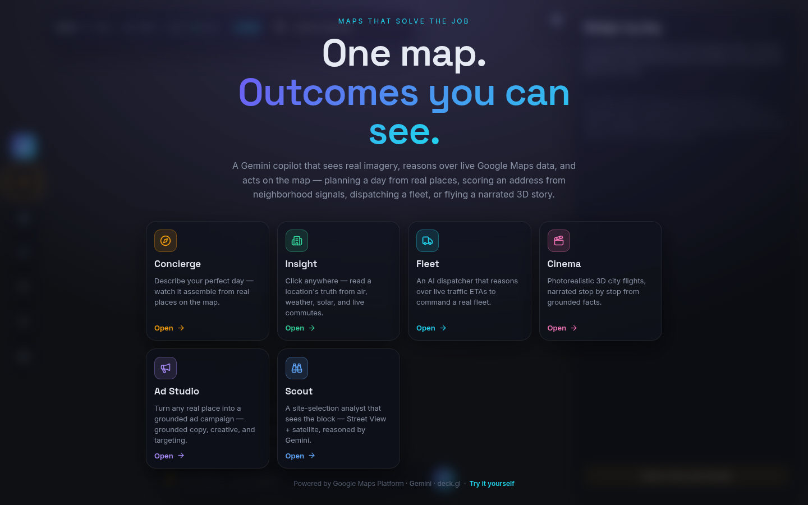

# Atlas: Real-World Reasoning Agent on Google Maps

[](LICENSE)
[](package.json)

> **A personal project by [Ryan Baumann](https://github.com/ryanbaumann).** Atlas is an independent demo built on the public [Google Maps Platform](https://developers.google.com/maps?utm_campaign=gmp_git_agentskills_v1) and [Gemini API](https://ai.google.dev/gemini-api/docs). Atlas is not an official Google product. Bring your own API keys; you control your usage and billing.

The canonical source lives in [ryanbaumann/fieldwork](https://github.com/ryanbaumann/fieldwork/tree/main/demos/real-world-reasoning-agent). Fieldwork serves the production build at `/real-world-reasoning-agent/`. See [PROVENANCE.md](PROVENANCE.md) for the pinned source snapshot and migration boundary.

Atlas is a Vite and React map agent. It combines Google Maps Platform data, Street View imagery, Maps Experience MCP tools, and `gemini-4-hydrogen` to evaluate locations and render interactive A2UI surfaces. Six journeys provide starting points for spatial tasks. Tool traces expose the retrieved evidence behind each result.



## Journeys

| Journey | What it does |
| :--- | :--- |
| **Concierge** | Turns one prompt or pasted Maps links into a walkable itinerary and shareable Google Maps List. |
| **Insight** | Evaluates any block across air quality, weather, solar potential, and live commutes with evidence. |
| **Fleet** | Tracks live traffic and compares route ETAs before assigning a van. |
| **Cinema** | Flies across a photorealistic 3D city with narration grounded in retrieved place data. |
| **Ad Studio** | Builds storefront campaigns with grounded copy, conditioned creatives, and walk-time targeting. |
| **Scout** | Inspects blocks on Street View, scores candidate corners, and defends its pick with evidence. |

## Core Developer Features

- **Visible tool traces:** Status chips and the live work panel show every tool call so you can compare retrieved data against the answer.
- **Google Maps Shortlists:** Paste Google Maps links (`google.com/maps/place/...`, `maps.app.goo.gl/...`), Place IDs, or queries to generate a 1-click Google Maps List (`map_action=shortlist`) with up to 20 canonical Place IDs.
- **Google Maps Experience MCP:** Proxies allowlisted JSON-RPC 2.0 tool calls (`search_places`, `search_along_route`, `compute_routes`, `lookup_weather`, `resolve_names`, `resolve_maps_urls`) to `https://mapstools.googleapis.com/mcp` and registers Agentic Data Visualization `contentToken` values on the Maps JS SDK.
- **Replay links:** Completed runs produce a 1-click link that reopens Atlas in the same journey and city to rerun the prompt live. Click **How it's built** in the header to inspect the active system prompt and tool declarations.

## Generative UI (`@googlemaps/a2ui@0.1.10`)

Every journey copilot renders interactive surfaces in the chat column through the `render_surface` tool. Atlas supports the [Maps Agentic UI Toolkit](https://github.com/googlemaps/a2ui) A2UI v1.0 and v0.9 envelopes (`a2ui://maps-agentic-ui-catalog.json` and `atlas://maps-agentic-ui-catalog`), including `GoogleMap` route/place props (`mode`, `origin`, `destination`, `routes`, `travelMode`, `placePrimaryType`, `contentToken`) and dark-themed `PlaceDetailsCompact` cards. CI validates wire compatibility against `@a2ui/web_core`. See [docs/GENUI.md](docs/GENUI.md).

## Voice Input

Tap the microphone in the copilot composer to dictate a request. Atlas transcribes audio with `gemini-4-hydrogen` at `LOW` thinking (override with `VITE_GEMINI_STT_MODEL`) and inserts the text into the composer for review. Recording starts only on an explicit tap, sends audio once through the same-origin `/ai` proxy, and releases the microphone immediately on stop. See [docs/FUTURE_WORK.md](docs/FUTURE_WORK.md) for Live API notes.

## Architecture

```text
Browser
  ├─ Maps JavaScript SDK with VITE_GMP_API_KEY (restricted browser key)
  ├─ A2UI surfaces <- render_surface tool <- gemini-4-hydrogen copilot
  ├─ /api/real-world-reasoning-agent/mcp   -> Fieldwork gateway -> mapstools.googleapis.com/mcp
  ├─ /api/real-world-reasoning-agent/gmp/* -> Fieldwork gateway -> Google Maps Platform REST/static APIs
  └─ /api/real-world-reasoning-agent/ai/*  -> Fieldwork gateway -> Gemini API (model-allowlisted)
```

Only the restricted browser Maps key ships in the client bundle. In production, `gateway/server.js` proxies Google Maps Platform REST, Maps Experience MCP, and Gemini API calls behind strict allowlists, rate limits, and daily caps. Users can also connect a personal Gemini key from the landing screen or **AI key** header button; the key stays in tab memory only and never enters URLs, storage, chat, or diagnostics.

### Model Configuration

Atlas uses `gemini-4-hydrogen` with low-latency defaults and on-demand deeper reasoning:
- **Orchestrator (`LOW` thinking default):** Runs fast multi-step spatial tool loops; switch to `MEDIUM` or `HIGH` in the Admin Panel or `VITE_GEMINI_CHAT_THINKING` for deeper planning.
- **Analysis and fast workers (`LOW` thinking):** Evaluate Street View and aerial imagery, generate follow-up chips, format answers, and transcribe voice input.
- **Generative video (`gemini-omni-1.2-flash`):** Renders optional tour and walkthrough clips.

Hosted requests default `RWR_HOSTED_AI_MAX_OUTPUT_TOKENS` to `32768` so reasoning tokens never starve tool or A2UI output.

### Bring Your Own Gemini Key

Open **Connect key** on the landing screen (or **AI key** in the header), paste a key from [Google AI Studio](https://aistudio.google.com/apikey), and select **Test and connect**. Atlas checks model access against `gemini-4-hydrogen` without generating billable tokens. Reloading the tab clears the key.

## Local Development

Prerequisites: Node.js 20.19+, a Google Cloud project with Maps JavaScript, Places (New), Routes, Map Tiles, Geocoding, Air Quality, Weather, Pollen, Solar, and Static Maps/Street View enabled ([create API keys](https://console.cloud.google.com/google/maps-apis/credentials)), and a [Gemini API key](https://aistudio.google.com/apikey).

1. Create an ignored `.env` file and set:
   - `VITE_GMP_API_KEY`: Restricted browser key for Maps JavaScript, Places (New), Routes, and Map Tiles.
   - `VITE_GMP_MAP_ID`: Optional public Map ID (defaults to `DEMO_MAP_ID` in `src/lib/config.ts`).
   - `GMP_SERVER_API_KEY`: Server key for Google Maps Platform REST, Static Maps, and Maps Experience MCP.
   - `GMP_MCP_KEY`: Optional dedicated key for `mapstools.googleapis.com/mcp` (falls back to `GMP_SERVER_API_KEY`).
   - `GEMINI_API_KEY`: Server key for Gemini reasoning and Google Maps Grounding.

2. Install dependencies and start the dev server:

   ```bash
   npm ci
   npm run dev
   ```

Vite mounts local development routes for `/api/real-world-reasoning-agent/capabilities`, `/mcp`, `/gmp/*`, and `/ai/*`.

## Fieldwork Production Integration

Build the workspace package from this directory:

```bash
npm run build
```

Fieldwork stages `dist/` at `/real-world-reasoning-agent/`. Run `npm run preview` to build the package and start the shared Fieldwork gateway from the repository root.

## Tests and Smoke Checks

Run `npm run test:unit` for the Vitest suite (A2UI protocol, `@a2ui/web_core` parity, Maps Shortlist URL hygiene, Maps Experience MCP fallback, and capability effects). Run `npm test` for typecheck, unit tests, and source-integrity checks.

Run `npm run smoke` against a running preview server with Chromium to verify that every journey renders:

```bash
npm run preview &
ALLOW_LIVE_MAPS_BROWSER=1 CHROMIUM_PATH=/path/to/chromium npm run smoke
```

## Security Notes

Keep `GMP_SERVER_API_KEY`, `GMP_MCP_KEY`, and `GEMINI_API_KEY` server-side only; never commit them. Restrict `VITE_GMP_API_KEY` by HTTP referrer and enabled Maps APIs. See [SECURITY.md](SECURITY.md) for key-handling rules.

## Contributing and License

See [CONTRIBUTING.md](CONTRIBUTING.md) for the workflow. Released under the [MIT License](LICENSE).
